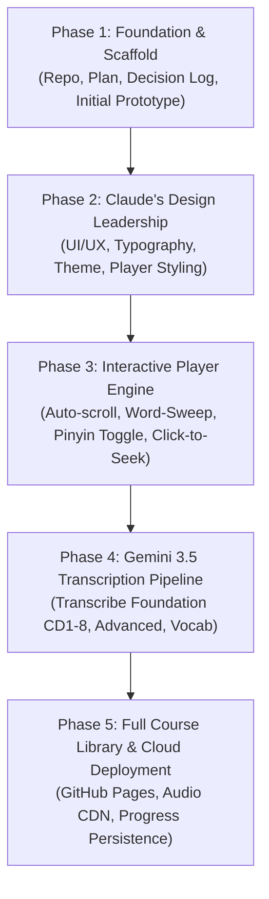

# Learning Chinese — Implementation & Architecture Plan

> **Author:** Gemini 3.8 & Collaborative Team  
> **Design Lead:** Claude  
> **Repository:** `scoresby13/learning-chinese` (Private)  
> **Date:** November 2026  
> **Version:** 1.0.0  

---

## 1. Executive Summary & Vision

The goal of this project is to build an interactive, lyrics-synchronized web application for learning Mandarin Chinese based on the audio-guided **Michel Thomas Mandarin Chinese Course** (~16 CDs).

### The Learning Problem
The Michel Thomas method is renowned for conversational mastery through active listening and response. A teacher guides two students in English, breaking down grammar and prompting them to form sentences in Mandarin. However:
1. **No Chinese transcripts exist** in the original package (transcripts only existed for French, German, Italian, and Spanish).
2. Beginners cannot verify whether they are hearing tones correctly or how spoken words correspond to written Chinese characters (**Hanzi**).
3. Traditional audio players offer no synchronized visual feedback, forcing learners to constantly pause and rewind blindly.

### The Solution: An Interactive "Karaoke" Reader
Our web application pairs audio playback with synchronized bilingual transcripts:
- **English speech** is rendered cleanly as English text.
- **Mandarin speech** is rendered as dual-layer text: Chinese characters (**Hanzi**) and Romanization with tone marks (**Pinyin**).
- **Pinyin Toggle Switch:** Users can toggle Pinyin on/off at will to test their character reading retention or provide a safety net.
- **Live "Lyrics" Synchronization:** Active sentences are highlighted in real time; the page smoothly autoscrolls to track the audio.
- **Word-by-Word Sweeping Highlight:** Characters/words glow sequentially as spoken by the teacher and students.
- **Click-to-Seek:** Clicking any line, character, or phrase instantly seeks the audio to that exact moment.
- **Hosted on GitHub Pages:** Accessible from any browser (desktop or mobile) with zero server maintenance.

---

## 2. Audio Corpus Inventory

The source dataset (the local course folder `learningchinese/Chinese`) consists of 16 CDs:

| Course Level | CD / Discs | Total Audio Tracks | Total Size | Description |
| :--- | :--- | :--- | :--- | :--- |
| **Chinese Foundation** | CD1 – CD8 | ~100 tracks | ~810 MB | Core foundational grammar, tones, sentence construction, core vocabulary. |
| **Chinese Advanced** | CD1 – CD4 | ~47 tracks | ~413 MB | Complex sentence patterns, connectors, conversational flow, idiomatic expressions. |
| **Chinese Vocabulary** | CD1 – CD4 | ~58 tracks | ~423 MB | Topic-specific vocabulary expansion and high-frequency phrases. |
| **Total** | **16 CDs** | **~205 tracks** | **~1.65 GB** | Complete Mandarin mastery curriculum. |

---

## 3. Gemini 3.5 Transcription Pipeline & Data Schema

### 3.1. Transcription Workflow
We will use Gemini's multimodal audio transcription capabilities to process each audio track. The pipeline will:
1. Ingest audio files in chunks or full track format (using `ffmpeg` for pre-processing/normalization).
2. Segment speech into conversational turns between:
   - `teacher`: Harold Goodman (delivers English explanations and prompts)
   - `student_f` / `student_m`: The learners responding in Mandarin
   - `native_guide`: Model native speaker providing accurate tonal corrections
3. Output structured, timestamped JSON conforming strictly to our standardized schema.

### 3.2. Standard Transcript JSON Schema (`track_transcript.schema.json`)
```json
{
  "trackId": "foundation-cd01-01",
  "course": "Foundation",
  "cd": 1,
  "track": 1,
  "title": "Foundation CD1 - Track 1: Introduction & Basic Greetings",
  "audioUrl": "audio/foundation-cd01/track-01.mp3",
  "durationSeconds": 418.5,
  "segments": [
    {
      "id": "seg-001",
      "start": 0.0,
      "end": 6.8,
      "speaker": "teacher",
      "type": "explanation",
      "language": "en",
      "english": "Welcome to the Michel Thomas Mandarin Chinese course.",
      "hanzi": "",
      "pinyin": "",
      "words": []
    },
    {
      "id": "seg-002",
      "start": 6.8,
      "end": 14.5,
      "speaker": "teacher",
      "type": "instruction",
      "language": "mixed",
      "english": "The word for 'not' or 'no' in Mandarin is bù.",
      "hanzi": "不",
      "pinyin": "bù",
      "words": [
        { "text": "The", "start": 6.8, "end": 7.1 },
        { "text": "word", "start": 7.1, "end": 7.4 },
        { "text": "for", "start": 7.4, "end": 7.6 },
        { "text": "not", "start": 7.6, "end": 8.0 },
        { "text": "is", "start": 8.0, "end": 8.3 },
        { "text": "bù", "hanzi": "不", "pinyin": "bù", "start": 8.3, "end": 9.2 }
      ]
    },
    {
      "id": "seg-003",
      "start": 14.5,
      "end": 20.2,
      "speaker": "student_f",
      "type": "practice",
      "language": "zh",
      "english": "It is not good.",
      "hanzi": "不好",
      "pinyin": "bù hǎo",
      "words": [
        { "hanzi": "不", "pinyin": "bù", "start": 16.0, "end": 17.1 },
        { "hanzi": "好", "pinyin": "hǎo", "start": 17.1, "end": 18.5 }
      ]
    }
  ]
}
```

### 3.3. Pinyin Representation Standard
- Tonal marks: Standard accented diacritics (`ā`, `á`, `ǎ`, `à`, `a`) for elegant visual readability.
- Layout: Supported natively via `<ruby>` and `<rt>` tags or custom stacked `div`/`span` pairs.
- Tone Coloring (Optional UI setting): Subtly color tones (1st: Red/Rose, 2nd: Green/Jade, 3rd: Blue/Azure, 4th: Purple/Plum, Neutral: Grey) to reinforce memory.

---

## 4. Web Application Architecture

### 4.1. Tech Stack
- **Build Tool:** [Vite](https://vitejs.dev/) — Lightning-fast development and optimized production bundling.
- **Frontend Architecture:** Lightweight TypeScript / React or Modern Vanilla ES Modules.
- **Styling:** CSS variables + modern responsive layout (Claude to lead design system and styling).
- **Audio Engine:** HTML5 Audio API with `requestAnimationFrame` interpolation for jitter-free, 60fps word highlight synchronization.
- **Deployment:** Single command build (`npm run build`) outputting static files into `dist/`, fully compatible with GitHub Pages.

### 4.2. Key Components & Features
```
┌─────────────────────────────────────────────────────────────────┐
│ Learning Chinese                             [Pinyin: ON|OFF]   │
│ Track: Foundation CD1 - Track 01              [Auto-Scroll: ON] │
├───────────────────────────────┬─────────────────────────────────┤
│ Track Selector (Sidebar)      │ Transcript Viewport (Karaoke)   │
│ ├── Foundation (CD 1-8)       │                                 │
│ │   ├── Track 01 [Active]     │ [00:15] Teacher:                │
│ │   ├── Track 02              │ "Now try to say: 'It is not     │
│ │   └── ...                   │  good'..."                      │
│ ├── Advanced (CD 1-4)         │                                 │
│ └── Vocabulary (CD 1-4)       │ [00:19] Student:                │
│                               │   bù   hǎo                      │
│                               │   不   好                       │
│                               │   [It is not good]              │
│                               │                                 │
│                               │ [00:24] Teacher:                │
│                               │ "Good! And how do you say..."   │
├───────────────────────────────┴─────────────────────────────────┤
│ Floating Player Controls                                        │
│ [<< 5s]  [ ▶ Play / Pause ]  [5s >>]    [01:24 / 06:58]  [1.0x] │
│ ─────────────────────────●───────────────────────────────────── │
└─────────────────────────────────────────────────────────────────┘
```

1. **Transcript Viewport (Lyrics / Karaoke):**
   - Active sentence highlighted with luminous contrast.
   - Word/character level sweep synchronized to audio time.
   - Clicking any sentence jumps playback to that sentence.
   - Smooth auto-scrolling with smart user interruption: if the user manually scrolls up to read earlier text, auto-scroll pauses and offers a floating "Resume Live Scroll" button.
2. **Pinyin Toggle Mechanism:**
   - Seamless transition without shifting sentence heights (CSS `visibility: hidden` or smooth height transition so text doesn't awkwardly jump when toggling).
3. **Audio Player Controls:**
   - Play/Pause, -5s / +5s skip buttons.
   - Scrubbable progress bar with time indicators.
   - Speed controls: `0.75x`, `0.9x`, `1.0x`, `1.1x`, `1.25x` (crucial for beginners dissecting fast native tones).
   - "Loop Current Sentence" button (repeats the current phrase until mastered).
4. **Navigation & Track Management:**
   - Collapsible drawer / sidebar grouping all 16 CDs and tracks.
   - Progress tracking: automatically remembers the learner's last played track and timestamp in `localStorage`.

---

## 5. Claude's Design Aesthetics & Ownership

> **Role for Claude:** Claude has complete artistic freedom and lead authority over the visual aesthetic, UI/UX feel, typography, color palette, and micro-interactions.

### 5.1. Suggested Design Directives for Claude
- **Atmospheric Palette:**
  - *Option A (Scholarly Zen):* Warm parchment / rice-paper background (`#F9F6F0`), cinnabar red accents (`#C84B31`), bamboo jade (`#2D5A4C`), deep sumi-e ink text (`#1E2022`).
  - *Option B (Modern Dark Minimalist):* Deep obsidian (`#121417`), warm gold accents (`#E5A93C`), soft slate cards (`#1E2229`), luminous white typography (`#F0F3F6`).
- **Typography Pairing:**
  - Chinese: Google Fonts `Noto Serif SC` (for elegant classical look) or `Noto Sans SC` (for ultra-crisp modern legibility).
  - English & Pinyin: `Plus Jakarta Sans`, `Inter`, or `Newsreader` for pristine readability.
- **Ruby Text Alignment:**
  - Perfect centering of Pinyin diacritics over Chinese characters.
  - Ensuring the toggle state does not distort vertical layout rhythm.
- **Micro-Interactions:**
  - Subtle hover glow on interactive transcript lines.
  - Smooth scale/opacity transitions for the active phrase.
  - Tactile playback button states and smooth scrubber handle.

---

## 6. Audio Hosting & Deployment Architecture

### 6.1. Challenge: 1.6 GB Audio vs GitHub Repositories
- Standard Git repositories are optimal under 1 GB, and GitHub limits individual files to 100MB.
- Pushing 1.6 GB of MP3 files directly to Git history could bloat clones.

### 6.2. Strategy
1. **Phase 1 (Development & Prototype):**
   - Foundation CD1 Track 1 audio file is included locally in `public/audio/` so the app is immediately testable upon cloning.
2. **Phase 2 (Production Hosting):**
   - Full audio library hosted via:
     - **Option 1 (GitHub Releases Assets):** Audio files uploaded to GitHub Release tags (free, fast, no repo bloat, allows direct URL streaming).
     - **Option 2 (Cloudflare R2 / Hugging Face):** Free-tier high-bandwidth object storage with custom CDN.
   - The frontend automatically points to the configured audio CDN URL base.

---

## 7. Phased Roadmap



### Milestone Details:
- **Phase 1 (Current):**
  - Create private GitHub repo `scoresby13/learning-chinese`.
  - Establish `DECISION_LOG.md` and `PLAN.md`.
  - Build working Vite webapp prototype with CD1 Track 1 sample data.
  - Push initial codebase to GitHub for Claude.
- **Phase 2 (Claude Handoff):**
  - Claude inspects `PLAN.md` and codebase.
  - Claude designs UI system, color palette, typography, and responsive layouts.
- **Phase 3 (Core Experience Polish):**
  - Integrate Pinyin toggle, karaoke scrolling, click-to-seek, and looping.
  - Test on mobile and desktop browsers.
- **Phase 4 (Audio Transcription):**
  - Run Gemini 3.5 transcription pipeline on the Chinese audio library.
  - Convert transcript outputs into validated JSON dataset.
- **Phase 5 (GitHub Pages Launch):**
  - Set up GitHub Actions workflow to build and deploy to GitHub Pages.
  - Document setup in `README.md`.
